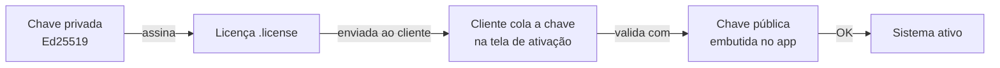
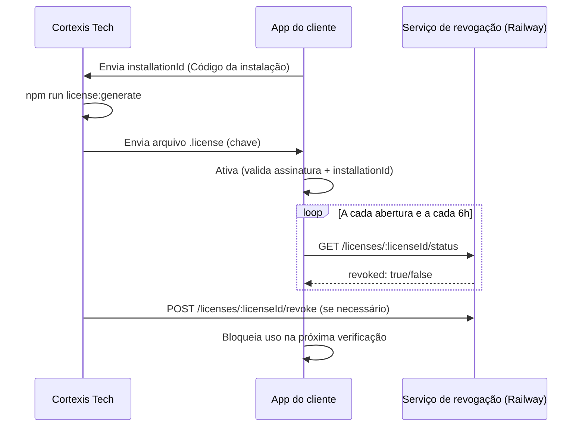

# Manual Completo de Licenciamento por Chave

Este manual cobre todo o ciclo de vida da licença do ERP Cortexis Tech: geração do par
de chaves, emissão, ativação pelo cliente, expiração, revogação remota e resolução de
problemas. É o documento de referência para quem emite, ativa ou revoga licenças.

## Índice

1. [Modelo e conceitos](#modelo-e-conceitos)
2. [Visão geral do ciclo de vida](#visão-geral-do-ciclo-de-vida)
3. [Preparação única — par de chaves](#preparação-única--par-de-chaves)
4. [Emitir uma licença](#emitir-uma-licença)
5. [Ativação pelo cliente](#ativação-pelo-cliente)
6. [Expiração](#expiração)
7. [Revogação remota](#revogação-remota)
8. [Painel web de gestão de licenças](#painel-web-de-gestão-de-licenças)
9. [Segurança e limitações](#segurança-e-limitações)
10. [Resolução de problemas](#resolução-de-problemas)
11. [Perguntas frequentes](#perguntas-frequentes)
12. [Glossário](#glossário)

## Modelo e conceitos

O aplicativo usa licenças offline assinadas com Ed25519. A chave privada emite licenças;
o aplicativo contém somente a chave pública e, portanto, consegue validar uma licença,
mas não consegue gerar outra.

Cada licença contém:

- `licenseId` — identificação única da licença (UUID gerado na emissão);
- `installationId` — código exibido na tela de ativação daquele computador;
- `customer` — nome do cliente;
- `edition` — `standard` ou `professional`;
- `issuedAt` — data de emissão;
- `expiresAt` — data de validade, ou `null` para licença perpétua;
- `modules` — opcional, lista dos módulos operacionais licenciados (ver abaixo).

A licença é vinculada ao `installationId` exibido no computador do cliente. Copiar
somente a chave para outro computador não ativa o sistema, porque o `installationId`
não vai corresponder.

### Licenciamento por módulo

Além dos cadastros básicos (produtos, categorias, fornecedores, clientes, sempre
disponíveis), sete módulos operacionais podem ser licenciados individualmente:
`compras`, `vendas`, `producao`, `estoque`, `financeiro`, `relatorios-avancados` e
`multi-empresa`. Quando o campo `modules` está ausente da licença — o caso de **toda
licença emitida antes desta funcionalidade** — o aplicativo usa a edição como
substituto: `professional` libera todos os módulos, `standard` não libera nenhum
módulo extra. Incluir `modules` explicitamente na licença (via `--modules` no CLI, ou
os checkboxes no Gerador de Licenças) sobrepõe esse padrão e vale à risca,
independentemente da edição — por exemplo, uma licença `standard` com
`modules: ["financeiro"]` libera só o Financeiro. Um módulo não licenciado
simplesmente não aparece no menu do cliente.



## Visão geral do ciclo de vida



## Preparação única — par de chaves

O par inicial já foi criado. Para uma implantação nova, execute apenas uma vez:

```bash
npm run license:keypair
```

Isso gera:

- a chave **privada** (Ed25519), salva no caminho absoluto definido em
  `CORTEXIS_LICENSE_PRIVATE_KEY` (fora do projeto e de pastas sincronizadas, ignorada
  pelo Git e pelo instalador);
- a chave **pública**, incorporada em `shared/license-public-key.ts` e embutida no
  binário distribuído.

Regras de segurança da chave privada:

- Configure `CORTEXIS_LICENSE_PRIVATE_KEY` com caminho absoluto antes de rodar qualquer
  comando de licenciamento.
- Faça ao menos duas cópias seguras e criptografadas (ex: gestor de senhas com anexos,
  cofre físico). Perder essa chave impede emitir novas licenças compatíveis.
- Vazar a chave permite a terceiros fabricar licenças válidas para qualquer instalação.
- **Não execute `npm run license:keypair` novamente** para um produto já distribuído: o
  script recusa sobrescrever se já existir, mas trocar o par manualmente invalida todas
  as licenças emitidas anteriormente no próximo build do aplicativo (a chave pública
  embutida muda).

## Emitir uma licença

Solicite ao cliente o **Código da instalação** exibido na tela de ativação e execute:

```bash
npm run license:generate -- \
  --customer "Empresa Cliente Ltda" \
  --installation "CODIGO-EXIBIDO-PELO-CLIENTE" \
  --edition professional \
  --days 365 \
  --modules compras,vendas,financeiro \
  --out /caminho/seguro/empresa-cliente.license
```

Parâmetros:

| Parâmetro | Obrigatório | Descrição |
|---|---|---|
| `--customer` | sim | Nome do cliente, gravado na licença. |
| `--installation` | sim | `installationId` exibido no computador do cliente. |
| `--edition` | não (padrão `standard`) | `standard` ou `professional`. |
| `--days` | não | Validade em dias (1 a 3650). Omitido = licença perpétua. |
| `--modules` | não | Lista separada por vírgula (`compras,vendas,producao,estoque,financeiro,relatorios-avancados,multi-empresa`). Omitido = usa o padrão da edição. |
| `--out` | não | Caminho do arquivo `.license` a gerar. Sem isso, a chave é impressa no terminal. |

O script recusa gerar a licença se a chave privada apontada por
`CORTEXIS_LICENSE_PRIVATE_KEY` não corresponder à chave pública embutida no código
(`shared/license-public-key.ts`) — isso evita emitir chaves incompatíveis com o build
atual.

Envie ao cliente **somente o conteúdo do arquivo `.license`** (a chave, que começa com
`CTX1-`); nunca envie a chave privada.

## Ativação pelo cliente

1. Abra o aplicativo.
2. Copie o **Código da instalação** exibido na tela e envie à Cortexis Tech.
3. Receba a chave emitida (arquivo `.license` ou texto colado por e-mail).
4. Cole a chave completa no campo de ativação.
5. Clique em **Ativar sistema**.

O processo de ativação em si não requer internet — a validação da assinatura é local.
Em Configurações, o usuário pode consultar cliente, edição, validade e identificação
(`licenseId`) da licença ativa.

Assim que a ativação é concluída com sucesso, o aplicativo dispara em segundo plano uma
primeira checagem de revogação (ver seção seguinte), para refletir imediatamente uma
eventual revogação prévia daquele `licenseId`.

## Expiração

Se a licença foi emitida com `--days`, ela deixa de validar sozinha na data marcada —
não é preciso nenhuma ação manual. A partir de 14 dias antes do vencimento, o aplicativo
regista um aviso (via telemetria) para acompanhamento proativo.

Licenças perpétuas (emitidas sem `--days`) nunca expiram por data; a única forma de
bloqueá-las é a revogação remota, descrita a seguir.

## Revogação remota

Existe um serviço complementar de revogação (`license-server/`, publicado no Railway)
que permite bloquear uma licença já ativada — perpétua ou não — sem depender de nova
atualização do aplicativo instalado no computador do cliente.

- **URL do serviço**: `https://cortexis-license-api-production.up.railway.app`
- **Código-fonte**: [license-server/](../license-server/README.md)

### Como o aplicativo verifica

O aplicativo consulta o serviço em segundo plano (na abertura, a cada 6 horas, e logo
após uma ativação) e guarda localmente o último estado conhecido, num arquivo de cache
no `userData`. Se a consulta não for possível (sem internet), o aplicativo continua a
confiar na última verificação bem-sucedida — não há bloqueio abrupto por falta de rede.

### Revogar via linha de comando

Para revogar, é preciso o `licenseId` (visível em Configurações no aplicativo do
cliente):

```bash
curl -X POST "https://cortexis-license-api-production.up.railway.app/licenses/<licenseId>/revoke" \
  -H "Authorization: Bearer $ADMIN_TOKEN" \
  -H "Content-Type: application/json" \
  -d '{"reason": "Cliente cancelou o contrato", "customer": "Empresa Cliente Ltda"}'
```

Para reverter uma revogação:

```bash
curl -X POST "https://cortexis-license-api-production.up.railway.app/licenses/<licenseId>/unrevoke" \
  -H "Authorization: Bearer $ADMIN_TOKEN"
```

Para consultar o status de uma licença (rota pública, sem token):

```bash
curl "https://cortexis-license-api-production.up.railway.app/licenses/<licenseId>/status"
```

O `ADMIN_TOKEN` está configurado como variável de ambiente no serviço Railway
`cortexis-license-api` e não deve ser exposto no aplicativo cliente nem versionado no
repositório.

## Painel web de gestão de licenças

Para o dia a dia, prefira o painel web em vez de `curl`:
**https://cortexis-license-api-production.up.railway.app/**

Passo a passo:

1. Abra a URL acima no navegador.
2. Cole o `ADMIN_TOKEN` no campo "Token administrativo" e clique em **Guardar e
   validar** — o token é testado contra o servidor e só fica guardado no
   `localStorage` do navegador se for válido (aparece o selo **Autenticado**).
3. Use **Verificar uma licença** para consultar rapidamente se um `licenseId`
   específico está revogado, sem precisar do token.
4. Use **Revogar licença** para bloquear uma instalação: informe o `licenseId`,
   opcionalmente o nome do cliente e o motivo, e clique em **Revogar**. Uma
   confirmação é exibida antes de executar.
5. A tabela **Licenças revogadas** lista tudo o que já foi bloqueado; use o campo de
   filtro para buscar por `licenseId`, cliente ou motivo, e o botão **Reverter** para
   desfazer uma revogação (também com confirmação).
6. Use **Sair / limpar** para remover o token deste navegador ao terminar, especialmente
   em computadores compartilhados.

## Segurança e limitações

- A validação principal é totalmente offline: não existe controlo de quantidade de
  ativações por servidor além da revogação manual descrita acima.
- O vínculo ao `installationId` reduz a cópia casual de uma chave entre computadores,
  mas um atacante com controlo administrativo e capacidade de modificar o binário pode
  tentar remover verificações.
- A revogação remota depende de conectividade periódica do computador do cliente; um
  computador permanentemente offline só será bloqueado quando voltar a ter rede.
- Nunca commite a chave privada de assinatura nem o `ADMIN_TOKEN` do serviço de
  revogação no repositório.

## Resolução de problemas

| Sintoma | Causa provável | Ação |
|---|---|---|
| "Esta chave pertence a outra instalação" | `installationId` da licença não bate com o computador do cliente | Reemitir a licença com o `--installation` correto. |
| "Licença expirada em ..." | Licença emitida com `--days` já venceu | Emitir nova licença (renovação). |
| "Esta licença foi revogada" | `licenseId` está na lista de revogação | Se foi engano, reverter no painel web ou via `curl .../unrevoke`. |
| Cliente ativou mas continua bloqueado após eu reverter a revogação | Cache local do app ainda não foi atualizado | Aguardar a próxima checagem (até 6h) ou reabrir o aplicativo, o que dispara verificação imediata. |
| Não consigo emitir licença: "chave privada não corresponde à chave pública incorporada" | `CORTEXIS_LICENSE_PRIVATE_KEY` aponta para o par errado, ou o par foi trocado após o build atual | Confirme o caminho da variável de ambiente e qual par foi usado no build distribuído. |
| Token do painel web sempre inválido | `ADMIN_TOKEN` incorreto ou não configurado no serviço Railway | Verificar/gerar de novo com `railway variable set ADMIN_TOKEN=... --service cortexis-license-api`. |

## Perguntas frequentes

**Uma licença revogada pode ser reativada com a mesma chave?**
Sim — revogação não apaga nem invalida a chave assinada, apenas marca o `licenseId`
como bloqueado no serviço remoto. Revertendo a revogação, a mesma chave volta a
funcionar assim que o app fizer a próxima checagem.

**Posso ter mais de uma licença ativa por instalação?**
Não. Cada instalação guarda uma única licença ativa por vez; ativar uma nova
substitui a anterior.

**O cliente pode transferir a licença para outro computador?**
Não diretamente — a licença está vinculada ao `installationId` daquele computador.
É preciso emitir uma nova licença com o `installationId` do novo computador.

**O que acontece se eu perder a chave privada de assinatura?**
Não será possível emitir novas licenças compatíveis com as já distribuídas. Licenças já
emitidas continuam válidas (a validação usa a chave pública embutida no app), mas
qualquer renovação ou nova venda exigirá gerar um novo par e um novo build — invalidando
todas as licenças perpétuas anteriores.

## Glossário

- **`installationId`** — identificador único gerado e guardado localmente pelo
  aplicativo em cada instalação; exibido na tela de ativação.
- **`licenseId`** — identificador único da licença emitida, usado para revogação.
- **Licença perpétua** — licença sem `expiresAt`, válida indefinidamente até revogação
  manual.
- **`ADMIN_TOKEN`** — segredo que autentica as rotas de revogação/listagem no serviço
  `cortexis-license-api`.

