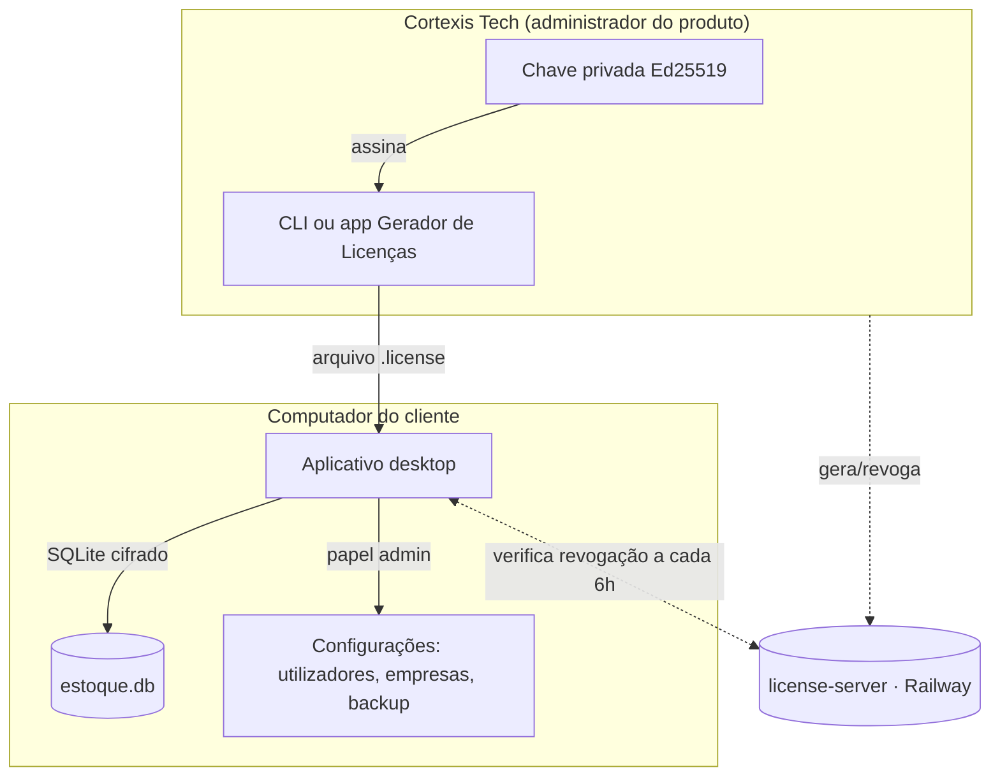

# Manual Completo do Administrador

Este manual reúne, num só lugar, tudo o que uma pessoa administradora precisa para
operar o ecossistema do ERP Cortexis Tech: emitir e gerir licenças (incluindo por
módulo), administrar utilizadores e empresas dentro do aplicativo, fazer cópias de
segurança e recuperação, e resolver os problemas mais comuns.

Há duas administrações distintas neste produto, e este manual cobre as duas:

- **Administrador do produto (Cortexis Tech / revendedor)** — quem gera e gere as
  licenças de cada cliente, mantém o par de chaves de assinatura e o serviço de
  revogação remota. Estas tarefas acontecem **fora** do aplicativo do cliente.
- **Administrador da instalação (perfil `admin` dentro do app)** — a pessoa, do lado do
  cliente, que ativa a licença recebida, cria utilizadores, empresas e faz a gestão do
  dia a dia em **Configurações**.

## Índice

1. [Visão geral do sistema](#1-visão-geral-do-sistema)
2. [Licenciamento — emitir e gerir licenças](#2-licenciamento--emitir-e-gerir-licenças)
3. [Administração dentro do aplicativo](#3-administração-dentro-do-aplicativo)
4. [Multi-empresa](#4-multi-empresa)
5. [Cópia de segurança, restauração e atualizações](#5-cópia-de-segurança-restauração-e-atualizações)
6. [Segurança](#6-segurança)
7. [Resolução de problemas](#7-resolução-de-problemas)
8. [Referência rápida de comandos](#8-referência-rápida-de-comandos)
9. [Glossário](#9-glossário)

---

## 1. Visão geral do sistema

O ERP Cortexis Tech — Controlo de Stock é uma aplicação **desktop** (Electron + React +
SQLite cifrado), distribuída por instalação, com licenciamento offline assinado. Não
existe um servidor central de dados: cada instalação guarda o seu próprio banco SQLite
em `{userData}/data/estoque.db`. Os únicos serviços online do ecossistema são:

- **`license-server`** (Node/Express + Postgres, hospedado no Railway) — só guarda
  metadados de licenças emitidas e o estado de revogação. Nunca recebe nem guarda a
  chave privada de assinatura, nem dados operacionais do cliente (produtos, faturas,
  clientes, etc.).
- **Sentry** (opcional) — telemetria de erros, se `SENTRY_DSN` estiver configurado.



Documentos de referência mais profundos, ligados a partir deste manual conforme
necessário:

- [Guia de Licenciamento por Chave](./GUIA-DE-LICENCIAMENTO-POR-CHAVE.md) — todo o
  ciclo de vida da licença, FAQ e glossário completo.
- [Guia de Operação, Manutenção e Recuperação](./GUIA-DE-OPERACAO-E-RECUPERACAO.md) —
  procedimentos técnicos de release, monitorização e incidentes.
- [Arquitetura de Criptografia da Base de Dados](./ARQUITETURA-DE-CRIPTOGRAFIA-DA-BASE-DE-DADOS.md).
- [Manual do Utilizador](./MANUAL-DO-UTILIZADOR.html) — operação diária (estoque,
  faturas, fabrico) para operadores e administradores do cliente.

## 2. Licenciamento — emitir e gerir licenças

Esta secção é um guia prático de execução. Para o modelo completo, casos-limite e FAQ,
consulte o [Guia de Licenciamento por Chave](./GUIA-DE-LICENCIAMENTO-POR-CHAVE.md).

### 2.1 Modelo em resumo

Cada licença é uma chave assinada offline (`CTX1-...`), vinculada ao `installationId`
do computador do cliente, e contém: cliente, edição (`standard`/`professional`),
validade (ou perpétua) e, opcionalmente, uma lista de **módulos** licenciados. Sem
`modules` explícito, `professional` libera tudo e `standard` libera só os cadastros
básicos (produtos, categorias, fornecedores, clientes) — isso garante que licenças já
emitidas antes do licenciamento por módulo continuem a funcionar sem reemissão.

Os sete módulos que podem ser licenciados individualmente:

| Módulo (`id`) | O que libera |
|---|---|
| `compras` | Faturação de entrada (compra de matérias-primas) |
| `vendas` | Faturação de saída (venda de produtos finais) |
| `producao` | Fabrico e Receita de Fabrico (BOM) |
| `estoque` | Ajustes de inventário e Inventário físico |
| `financeiro` | Contas a pagar e a receber |
| `relatorios-avancados` | Página de Relatórios (o Painel básico é sempre visível) |
| `multi-empresa` | Criar mais de uma empresa na mesma instalação |

Um módulo não licenciado simplesmente **não aparece** no menu do cliente, e o
aplicativo também recusa a operação correspondente ao nível do processo principal —
não é apenas uma restrição visual.

### 2.2 Preparação única — par de chaves

Só é feita uma vez por produto (já foi feita para este). Para uma implantação nova:

```bash
npm run license:keypair
```

Isto grava a chave privada no caminho absoluto definido por
`CORTEXIS_LICENSE_PRIVATE_KEY` (guarde-a fora do repositório, com pelo menos duas
cópias seguras) e incorpora a chave pública em `shared/license-public-key.ts`. Ver
regras completas de segurança da chave privada no
[Guia de Licenciamento](./GUIA-DE-LICENCIAMENTO-POR-CHAVE.md#preparação-única--par-de-chaves).

### 2.3 Emitir uma licença — linha de comando

O caminho mais rápido para quem já tem o repositório e o terminal disponíveis:

```bash
export CORTEXIS_LICENSE_PRIVATE_KEY=/caminho/seguro/license-private-key.pem

npm run license:generate -- \
  --customer "Empresa Cliente Ltda" \
  --installation "CODIGO-EXIBIDO-PELO-CLIENTE" \
  --edition professional \
  --days 365 \
  --modules compras,vendas,financeiro \
  --out /caminho/seguro/empresa-cliente.license
```

| Parâmetro | Obrigatório | Descrição |
|---|---|---|
| `--customer` | sim | Nome do cliente, gravado na licença. |
| `--installation` | sim | `installationId` exibido em Configurações → Licença, no computador do cliente. |
| `--edition` | não (padrão `standard`) | `standard` ou `professional`. |
| `--days` | não | Validade em dias (1–3650). Omitido = licença perpétua. |
| `--modules` | não | Lista separada por vírgula, dos 7 IDs da tabela acima. Omitido = usa o padrão da edição. |
| `--out` | não | Caminho do arquivo `.license`. Sem isso, a chave é impressa no terminal. |

Envie ao cliente **apenas o conteúdo do arquivo `.license`** (a chave, começando por
`CTX1-`) — nunca a chave privada.

### 2.4 Emitir uma licença — app Gerador de Licenças (interface gráfica)

Alternativa sem terminal, útil para quem não mexe habitualmente com linha de comando.
É um aplicativo Electron **independente** deste projeto, em `license-generator/`.

```bash
cd license-generator
npm install
npm start
```

Passo a passo na janela:

1. **Etapa 1 — Chave privada**: clique em "Selecionar arquivo PEM" e escolha o ficheiro
   da chave privada. O aplicativo confirma que ela corresponde à chave pública
   incorporada no build atual antes de aceitar.
2. **Registo no painel online (opcional)**: cole o `ADMIN_TOKEN` do `license-server`
   para que toda licença emitida fique automaticamente registada no painel de gestão
   (ver secção 2.6). Sem token, a emissão funciona normalmente, só não fica registada.
3. **Etapa 2 — Dados da licença**: preencha Cliente e Código da instalação, escolha
   Edição, defina a validade em dias (ou marque "Licença perpétua"), e marque os
   módulos desejados — deixe todos desmarcados para usar o padrão da edição.
4. Clique em **Gerar chave de licença**.
5. **Etapa 3 — Resultado**: confira o resumo (cliente, edição, validade, módulos), e
   use **Copiar chave**, **Salvar arquivo .license**, ou **Registar no painel online**
   (se ainda não tiver sido registada automaticamente).

Para gerar instaladores portáteis do gerador (Windows/macOS), ver
`license-generator/README.md`.

### 2.5 Ativação pelo cliente

1. O cliente abre o aplicativo pela primeira vez e vê o **Código da instalação**.
2. Envia esse código à Cortexis Tech.
3. Recebe a chave (`.license`) e cola-a no campo de ativação.
4. Clica em **Ativar sistema**.

A ativação em si é local (a assinatura é validada offline); só depois disso o
aplicativo faz, em segundo plano, a primeira checagem de revogação.

### 2.6 Revogação remota e painel online

Serviço complementar (`license-server/`, hospedado no Railway) que permite bloquear uma
licença já ativada — perpétua ou não — sem exigir uma nova versão do aplicativo.

- **Painel web**: `https://cortexis-license-api-production.up.railway.app/` — cole o
  `ADMIN_TOKEN`, veja a lista de **licenças emitidas** (agora com coluna de módulos) e
  de **licenças revogadas**, revogue/reverta com confirmação.
- **Linha de comando**, quando preferir `curl`:

```bash
# Revogar
curl -X POST "https://cortexis-license-api-production.up.railway.app/licenses/<licenseId>/revoke" \
  -H "Authorization: Bearer $ADMIN_TOKEN" -H "Content-Type: application/json" \
  -d '{"reason": "Cliente cancelou o contrato", "customer": "Empresa Cliente Ltda"}'

# Reverter
curl -X POST "https://cortexis-license-api-production.up.railway.app/licenses/<licenseId>/unrevoke" \
  -H "Authorization: Bearer $ADMIN_TOKEN"

# Consultar (rota pública, sem token)
curl "https://cortexis-license-api-production.up.railway.app/licenses/<licenseId>/status"
```

O aplicativo do cliente consulta este serviço na abertura e a cada 6 horas; sem
internet, continua a confiar na última verificação bem-sucedida.

## 3. Administração dentro do aplicativo

Tudo nesta secção acontece em **Configurações**, visível apenas ao perfil `admin` do
cliente (operadores só veem "A minha conta" e "Aparência").

### 3.1 Utilizadores

Painel **Utilizadores registados**:

- **+ Novo utilizador** — nome, utilizador, perfil (`admin`/`operador`) e palavra-passe
  temporária (mínimo 10 carateres, com maiúscula, minúscula, número e carácter
  especial); o utilizador é obrigado a trocá-la no primeiro acesso.
- **Inativar / Ativar** — bloqueia ou restaura o acesso sem apagar o histórico associado
  a esse utilizador (auditoria, faturas criadas, etc.).
- **Redefinir palavra-passe** — define uma nova temporária para outro utilizador (não
  para si próprio — use "Alterar a minha palavra-passe").

### 3.2 Identidade visual da empresa

Nome e logótipo exibidos no menu lateral do cliente (a Cortexis Tech continua
identificada como desenvolvedora no rodapé). Aceita PNG, JPG, WEBP ou SVG até 2 MB.

### 3.3 Diagnóstico e pacote de suporte

Estado técnico local (versão do esquema da base de dados, integridade, última cópia
automática, contagem de erros recentes) sem expor produtos, clientes, palavras-passe ou
chaves. **Gerar pacote de suporte** empacota essas informações para enviar à Cortexis
Tech ao abrir um chamado.

## 4. Multi-empresa

Módulo opcional (`multi-empresa`, ver secção 2.1) que permite gerir mais de uma empresa
na mesma instalação/base de dados — útil para um escritório de contabilidade ou um
grupo com várias razões sociais que preferem manter tudo num só computador.

### 4.1 Como funciona

Toda instalação já nasce com uma empresa (**"Empresa Principal"**) e funciona
normalmente mesmo sem o módulo licenciado — o módulo só é necessário para **criar uma
segunda** empresa. Cada empresa tem os seus próprios produtos, categorias, fornecedores,
clientes, faturas, produção, estoque, financeiro e inventário — completamente isolados
entre si; nada é partilhado entre empresas exceto os utilizadores (login) e as
definições globais do aplicativo (identidade visual, tema, licença).

### 4.2 Gerir empresas

Em **Configurações → Empresas** (painel só visível com o módulo licenciado):

- **+ Nova empresa** — nome (obrigatório), NIF, morada, telefone, e-mail.
- **Editar** — atualiza os dados cadastrais.
- **Inativar / Ativar** — uma empresa inativa não pode ser selecionada; o sistema exige
  manter **sempre pelo menos uma empresa ativa**.

### 4.3 Trocar a empresa ativa

Com mais de uma empresa ativa, um seletor aparece no topo do aplicativo, ao lado do
nome do utilizador — disponível para **qualquer utilizador autenticado** (admin ou
operador), não é restrito a administradores. Ao trocar, a janela recarrega para
garantir que nenhuma tela fique a mostrar dados da empresa anterior por engano.

> A empresa ativa é lembrada entre reinícios do aplicativo (persistida localmente), mas
> **não** é uma permissão por utilizador — todos que acedem a esta instalação partilham
> a mesma empresa selecionada até alguém trocar novamente.

## 5. Cópia de segurança, restauração e atualizações

Resumo prático; procedimentos técnicos aprofundados (backup programático, verificação
de integridade via SQL, troubleshooting de performance) estão no
[Guia de Operação, Manutenção e Recuperação](./GUIA-DE-OPERACAO-E-RECUPERACAO.md).

1. **Exportar backup** — Configurações → Cópia de segurança → **Escolher localização e
   guardar**. Gera um `.db` num ponto seguro (cópia segura mesmo com o aplicativo em
   uso, via API de backup do SQLite).
2. **Restaurar backup** — Configurações → **Restaurar cópia**, escolha o `.db` e
   confirme o aviso de substituição (**substitui todos os dados atuais**, de todas as
   empresas da instalação).
3. **Atualizações** — em builds instalados, o aplicativo verifica automaticamente na
   abertura; **Verificar atualizações** força uma checagem manual, e **Reiniciar e
   atualizar** aplica uma atualização já transferida.

> Nunca copie/substitua manualmente `estoque.db`, `-wal` ou `-shm` numa instalação
> cifrada — use sempre a exportação/restauração pelo aplicativo.

## 6. Segurança

- A base de dados é cifrada (AES-256 via SQLCipher, ver
  [arquitetura de criptografia](./ARQUITETURA-DE-CRIPTOGRAFIA-DA-BASE-DE-DADOS.md)).
- Licenciamento é offline e assinado com Ed25519; a chave privada nunca sai do
  computador de quem emite licenças e nunca é enviada a nenhum servidor.
- Módulos não licenciados são recusados também no processo principal do Electron
  (IPC), não apenas escondidos na interface — contornar a UI não dá acesso.
- Cada empresa (multi-empresa) tem os dados isolados por `company_id` em todas as
  tabelas de negócio, reforçado nas próprias consultas SQL, não só na interface.
- Ver também a [Avaliação de Segurança](./AVALIACAO-DE-SEGURANCA-2026-08-24.md) para o
  histórico de testes executados.

## 7. Resolução de problemas

| Situação | Onde resolver |
|---|---|
| Licença rejeitada, expirada ou revogada | [Guia de Licenciamento — Resolução de problemas](./GUIA-DE-LICENCIAMENTO-POR-CHAVE.md#resolução-de-problemas) |
| App não inicia, banco corrompido, performance degradada | [Guia de Operação — Troubleshooting](./GUIA-DE-OPERACAO-E-RECUPERACAO.md#4-troubleshooting) |
| Saldo de estoque inconsistente | [Guia de Operação — 4.2](./GUIA-DE-OPERACAO-E-RECUPERACAO.md#42-saldo-inconsistente) |
| Módulo não aparece para o cliente mesmo após reemitir a licença | Confirme que o cliente **reativou** a nova chave em Configurações (a antiga permanece ativa até ser substituída); confirme os IDs de módulo digitados em `--modules` (erros de digitação são recusados na emissão, não silenciosamente ignorados). |
| Não é possível criar uma segunda empresa | Confirme que a licença ativa inclui o módulo `multi-empresa` (Configurações → Sobre o sistema → "Módulos incluídos" lista os módulos correntes). |
| "É necessário manter pelo menos uma empresa ativa" | Ative outra empresa antes de inativar esta — a regra é intencional, nunca pode ficar zero empresas ativas. |

## 8. Referência rápida de comandos

| Comando | Descrição |
|---|---|
| `npm run license:keypair` | Gera o par de chaves (uma única vez por produto). |
| `npm run license:generate -- --customer ... --installation ... [--edition] [--days] [--modules] [--out]` | Emite uma licença via terminal. |
| `cd license-generator && npm start` | Abre o Gerador de Licenças (interface gráfica). |
| `npm run dev` | Ambiente de desenvolvimento (Vite + Electron). |
| `npm run dev:web` | Preview no navegador, API em memória (licença "Profissional" simulada, todos os módulos liberados). |
| `npm run build` / `npm run electron:build` | Build de produção / empacotamento do instalador. |
| `npm run manual` / `manual:administrador` / `manual:licenciamento` / `manual:developer` | Regeneram os manuais em PDF a partir das fontes em `docs/`. |

## 9. Glossário

- **`installationId`** — identificador único de cada instalação, exibido na tela de
  ativação; a licença é vinculada a ele.
- **`licenseId`** — identificador único da licença emitida; usado para revogação.
- **Edição** — `standard` ou `professional`; decide os módulos por padrão quando
  `modules` não é especificado na licença.
- **Módulo** — funcionalidade operacional licenciável individualmente (ver tabela na
  secção 2.1); independente da edição quando especificado explicitamente.
- **`company_id`** — coluna que isola os dados de cada empresa, no recurso
  multi-empresa.
- **`ADMIN_TOKEN`** — segredo que autentica as rotas administrativas do
  `license-server` (emissão de registo, revogação, listagem).
